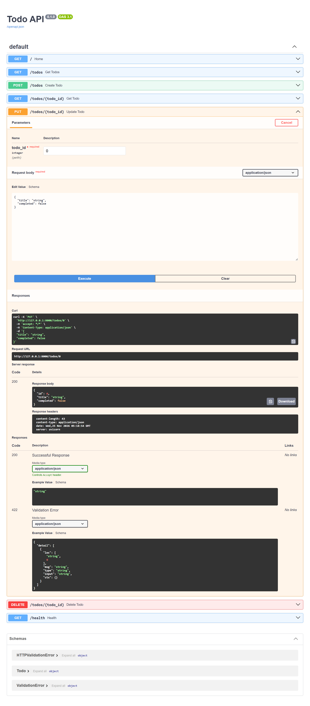

# Backend Development PBL - Todo API

A FastAPI-based Todo REST API created for a backend development project. The project demonstrates REST API development, Swagger/OpenAPI documentation, automated API testing, Docker containerization, Docker Compose, GitHub Actions CI/CD, and Docker Hub image publishing.

<p align="center">
  
</p>

## Table of Contents

- [Features](#features)
- [Technology Stack](#technology-stack)
- [Project Structure](#project-structure)
- [API Endpoints](#api-endpoints)
- [Prerequisites](#prerequisites)
- [Run Locally](#run-locally)
- [Run with Docker](#run-with-docker)
- [Automated Testing](#automated-testing)
- [GitHub Actions CI/CD](#github-actions-cicd)
- [Example Requests](#example-requests)
- [Screenshots](#screenshots)
- [Important Notes](#important-notes)

## Features

- Fast and lightweight FastAPI application
- Complete Todo CRUD operations
- Health check endpoint
- Automatic interactive Swagger UI documentation
- Automatic ReDoc API documentation
- In-memory Todo storage
- Python-based automation tests
- Docker and Docker Compose support
- GitHub Actions workflow for testing and Docker image publishing

## Technology Stack

| Technology | Purpose |
|---|---|
| Python 3.12 | Application runtime |
| FastAPI | REST API framework |
| Uvicorn | ASGI server |
| Pydantic | Request data validation |
| Docker | Application containerization |
| Docker Compose | Multi-container project setup |
| GitHub Actions | Automated testing and deployment |
| Docker Hub | Container image registry |

## Project Structure

```text
Backend-Development-PBL/
|-- .github/
|   `-- workflows/
|       `-- ActionsYaml.yaml
|-- sceershots/
|   |-- Screenshot 2026-11-25 104356.png
|   |-- Screenshot 2026-11-25 111826.png
|   |-- Screenshot 2026-11-25 111942.png
|   |-- Todo-API-Swagger-UI.png
|   |-- Todo-API-Swagger-UI 1.png
|   `-- Todo-API-Swagger-UI 4.png
|-- .gitignore
|-- Dockerfile
|-- README.md
|-- automationTesting.py
|-- docker-compose.yml
|-- main.py
`-- requirements.txt
```

## API Endpoints

| Method | Endpoint | Description | Success Response |
|---|---|---|---|
| `GET` | `/` | Check whether the API is running | `200 OK` |
| `GET` | `/health` | Check API health | `200 OK` |
| `GET` | `/todos` | Get all Todos | `200 OK` |
| `GET` | `/todos/{todo_id}` | Get a Todo by ID | `200 OK` |
| `POST` | `/todos` | Create a new Todo | `200 OK` |
| `PUT` | `/todos/{todo_id}` | Update an existing Todo | `200 OK` |
| `DELETE` | `/todos/{todo_id}` | Delete a Todo | `200 OK` |

An invalid Todo ID returns:

```json
{
  "detail": "Todo not found"
}
```

## Prerequisites

Choose one setup method:

- Python 3.12 and `pip`
- Docker Desktop or Docker Engine
- Docker Compose

Optional:

- GitHub account
- Docker Hub account

## Run Locally

### 1. Clone the repository

```powershell
git clone https://github.com/kaveerchaudhary-cpu/Backend-Development-PBL.git
cd Backend-Development-PBL
```

### 2. Create and activate a virtual environment

```powershell
python -m venv .venv
.venv\Scripts\Activate.ps1
```

### 3. Install dependencies

```powershell
pip install -r requirements.txt
```

### 4. Start the FastAPI server

```powershell
uvicorn main:app --reload --host 0.0.0.0 --port 8000
```

Open:

- API: <http://localhost:8000/>
- Health check: <http://localhost:8000/health>
- Swagger UI: <http://localhost:8000/docs>
- ReDoc: <http://localhost:8000/redoc>
- OpenAPI JSON: <http://localhost:8000/openapi.json>

## Run with Docker

### Build and start with Docker Compose

```powershell
docker compose up --build
```

The API will be available at <http://localhost:8000/>.

Stop and remove the containers:

```powershell
docker compose down
```

### Build and run using Docker manually

```powershell
docker build -t todo-api:v1 .
docker run --name todo-api-container -p 8000:8000 todo-api:v1
```

To view running containers:

```powershell
docker ps
```

To stop and remove the container:

```powershell
docker stop todo-api-container
docker rm todo-api-container
```

## Automated Testing

Start the API, then run:

```powershell
python automationTesting.py
```

The script tests:

- Home route
- Health route
- Todo creation
- Todo listing
- Todo retrieval by ID
- Todo update
- Todo deletion

The expected output includes a pass message for every test:

```text
PASS: Home route
PASS: Health route
PASS: Create Todo
PASS: Get all Todos
PASS: Get Todo by ID
PASS: Update Todo
PASS: Delete Todo
ALL TESTS PASSED!
```

## GitHub Actions CI/CD

The workflow is located at [`.github/workflows/ActionsYaml.yaml`](./.github/workflows/ActionsYaml.yaml).

It runs automatically whenever code is pushed to the `main` branch and performs these steps:

1. Checks out the repository
2. Sets up Python 3.12
3. Installs dependencies
4. Starts the FastAPI server
5. Runs the automation test script
6. Logs in to Docker Hub
7. Builds `todo-api:v1`
8. Pushes the image to Docker Hub

Configure these repository secrets before running the workflow:

| GitHub Secret | Description |
|---|---|
| `DOCKERUSERNAME` | Docker Hub username |
| `DOCKERTOKEN` | Docker Hub access token |

The workflow pushes the image with this pattern:

```text
<DOCKERUSERNAME>/todo-api:v1
```

## Example Requests

### Create a Todo

```powershell
Invoke-RestMethod -Method Post `
  -Uri "http://localhost:8000/todos" `
  -ContentType "application/json" `
  -Body '{"title":"Learn FastAPI","completed":false}'
```

### Get all Todos

```powershell
Invoke-RestMethod -Method Get -Uri "http://localhost:8000/todos"
```

### Get one Todo

```powershell
Invoke-RestMethod -Method Get -Uri "http://localhost:8000/todos/0"
```

### Update a Todo

```powershell
Invoke-RestMethod -Method Put `
  -Uri "http://localhost:8000/todos/0" `
  -ContentType "application/json" `
  -Body '{"title":"Learn FastAPI and Docker","completed":true}'
```

### Delete a Todo

```powershell
Invoke-RestMethod -Method Delete -Uri "http://localhost:8000/todos/0"
```

### Sample Todo object

```json
{
  "id": 0,
  "title": "Learn FastAPI",
  "completed": false
}
```

## Screenshots

### API root route

The root endpoint returns a running status message.


### Swagger UI - complete API

The Swagger interface provides interactive documentation and request testing for all endpoints.


### Swagger UI - update endpoint

The update endpoint accepts the Todo ID and a JSON request body.



### Swagger UI - health endpoint

The health endpoint shows a successful response and confirms that the service is healthy.


### Project files in VS Code

The project files and folder structure opened in Visual Studio Code.


### Initial Git commit

The project was added and committed in Git from the VS Code terminal.


## Important Notes

- Todos are stored only in memory. Data is lost when the application restarts.
- The API is designed for learning and demonstration purposes.
- A database and persistent storage are not currently configured.
- Authentication and authorization are not included.
- CORS configuration is not included.
- The automation script resets by starting with the current in-memory Todo list; stop and restart the API if test data has already been created and ID assumptions may conflict.